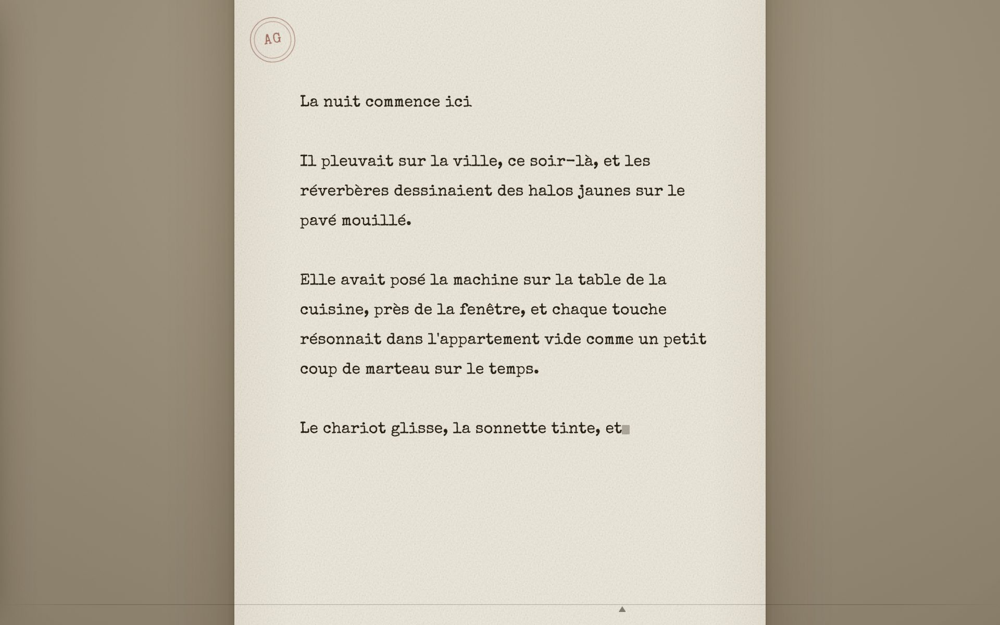

# Machine à écrire

Un éditeur de texte des plus sobres, au ressenti machine à écrire.



Une feuille de papier légèrement granuleuse, une ligne de frappe fixe : le texte
naît en bas de l'écran et remonte à mesure qu'on écrit, comme une page qui
s'enroule autour du cylindre. Pas de barre d'outils, pas de menus — juste
l'écriture.

## L'essentiel

- **La ligne de frappe.** La ligne en cours d'écriture reste toujours à la même
  hauteur ; c'est le papier qui remonte. Un petit index sur le rail, en bas,
  suit la position du chariot.
- **Un vrai éditeur.** Curseur, sélection, insertion au milieu du texte,
  annuler/rétablir, copier-coller : tout le comportement natif est conservé.
  La molette fait défiler la feuille pour se relire ; la frappe ramène
  aussitôt à la ligne de travail.
- **Les sons de la machine.** Frappe, barre d'espace, retour arrière, glissement
  du chariot avec sa butée, et la sonnette à l'approche de la marge droite —
  tous synthétisés en Web Audio, sans aucun fichier son. Débrayables.
- **Le tampon `AG`.** Poinçonné dans la marge, en haut à gauche. Un clic ouvre
  le volet des feuilles : vos projets d'écriture, enregistrés en continu dans
  le navigateur (`localStorage`), exportables en `.txt`.

## Utilisation

Ouvrir `index.html` dans un navigateur, et écrire. C'est tout.

Aucune dépendance, aucun outil de build, aucun serveur : trois fichiers
statiques et une police embarquée. Pour servir le dossier localement :

```bash
python3 -m http.server 8000
```

### Gestes

| Geste | Effet |
|---|---|
| clic sur le tampon `AG` | ouvre / ferme le volet des feuilles |
| `Échap` | ferme le volet |
| molette / toucher | fait défiler la feuille |
| `Tab` | tabulation (quatre espaces) |
| clic sur le papier, hors texte | revient à la fin du texte |

## Données

Les feuilles vivent dans le `localStorage` du navigateur : rien ne quitte
votre machine. L'enregistrement est automatique à chaque frappe. Le volet
permet d'exporter la feuille courante en `.txt`.

## Crédits

Police [Special Elite](https://fonts.google.com/specimen/Special+Elite)
d'Astigmatic (Apache License 2.0), embarquée dans `fonts/`.
